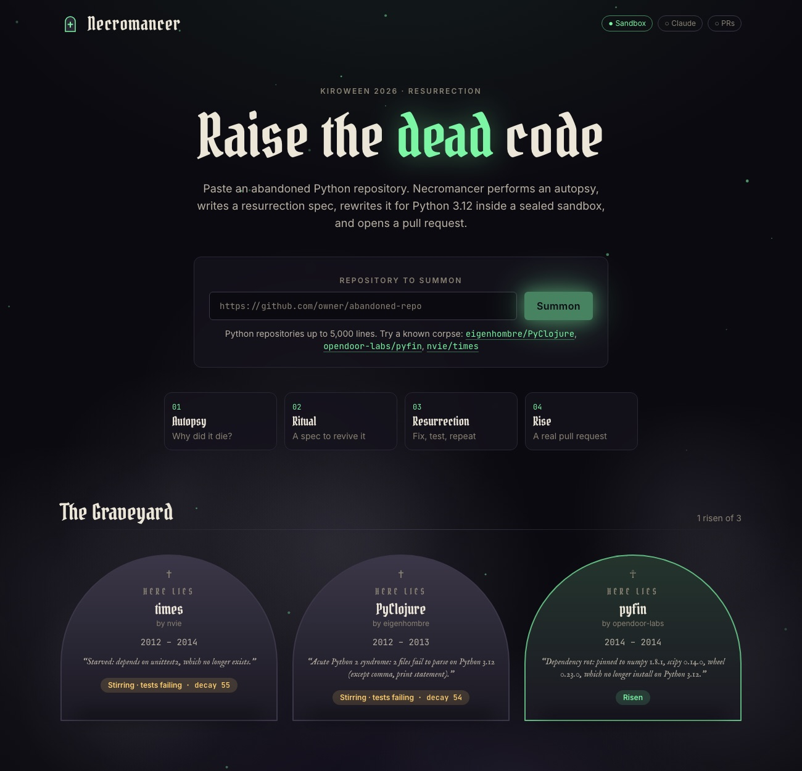
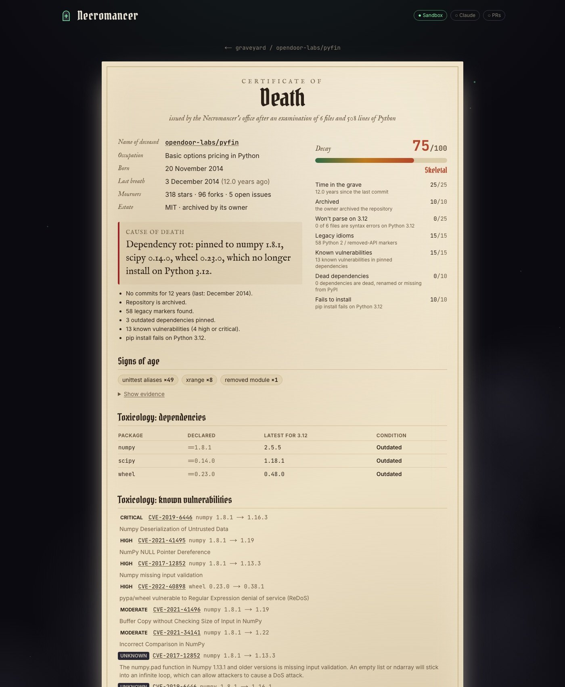
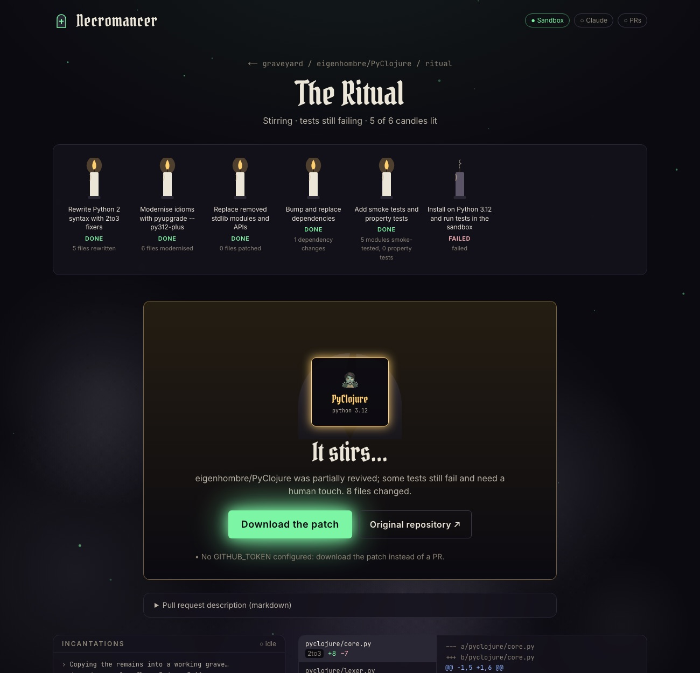
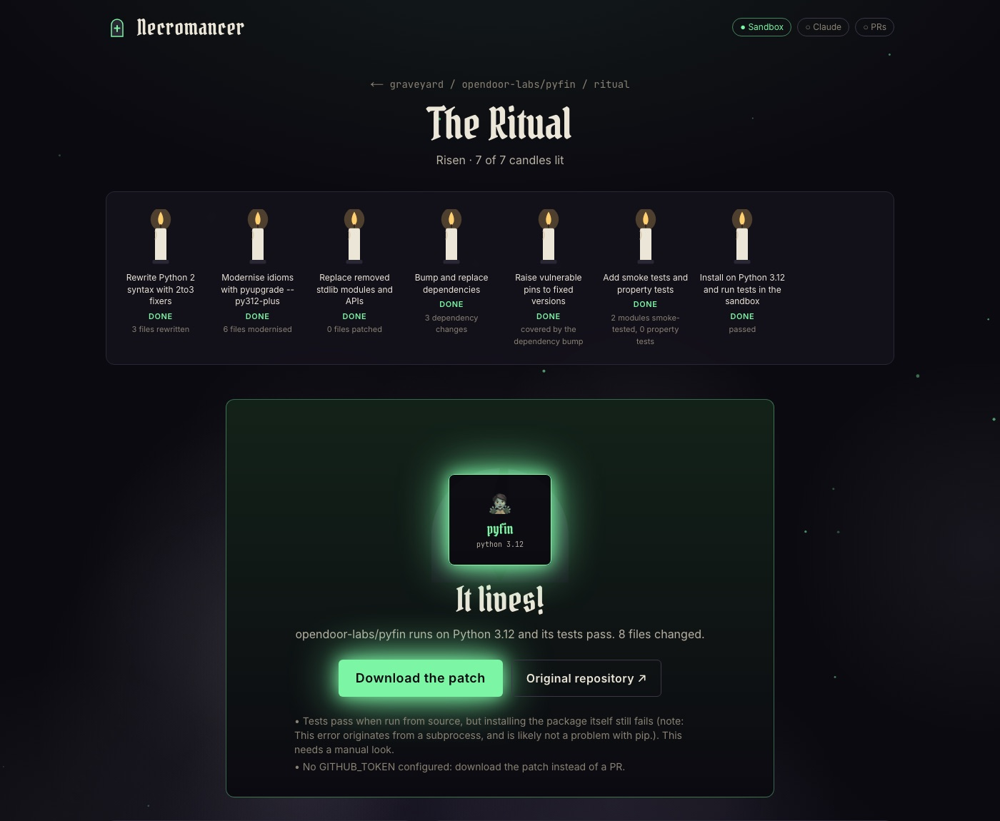

# 🧟 Necromancer

**Resurrects abandoned open-source Python repositories.** Paste a dead GitHub repo, get an
autopsy, a resurrection spec, and a working pull request for Python 3.12.

Built for **Kiroween 2026**, category: **Resurrection**.

```
Summon ──▶ Autopsy ──▶ Ritual ──▶ Resurrection ──▶ Rise
 URL       Death        Kiro-style   2to3 → pyupgrade →     Pull request
           Certificate  spec         API fixes → deps →     (or a patch)
           + decay      (req/design/ sandbox tests →
           score        tasks)       Claude repair loop
```

| | |
|---|---|
|  |  |
|  |  |

All four are real screenshots of the three demo repos. The two "Stirring" graves are honest: their tests
still fail without a Claude key (see [Results](#results-on-the-demo-repos)).

## Why

Modern software rests on thousands of packages nobody maintains anymore: no commits in years,
broken on current Python, full of known CVEs. Teams keep running them because rewriting is
expensive. Necromancer explains *why* a project died and brings it back automatically,
showing every change and proving it with tests.

## What it does

1. **Autopsy** (about 10 s): clones the repo (shallow, size-capped, git hooks disabled) and writes a
   **Death Certificate**:
   - vital records from the GitHub API (born, last commit, stars, archived)
   - Python 2 / removed-API markers found by a static scanner that never imports the code
     (print statements, `except X, e`, `iteritems`, `urllib2`, `imp`, `collections.Mapping`, …)
   - every declared dependency checked against PyPI for the newest release that supports 3.12,
     plus a table of dead packages (`nose`, `pycrypto`, `unittest2`, …)
   - known vulnerabilities from the **OSV** batch API, with CVSS-derived severity and fix versions
   - an install probe: `pip install` on Python 3.12 inside the Docker sandbox
   - a **decay score** from 0 to 100 with a visible breakdown, and a one-line **cause of death**
2. **Ritual**: a deterministic Kiro-style spec (`requirements.md` with EARS criteria,
   `design.md`, `tasks.md`) generated from the findings.
3. **Resurrection**: tasks run in order, each one streamed live as a diff:
   - **2to3** fixers via [`fissix`](https://github.com/jreese/fissix) (static, no execution)
   - **pyupgrade** `--py312-plus`
   - a removed-API replacement table (`collections.abc`, `base64.encodebytes`, unittest aliases, `mock` → `unittest.mock`, …)
   - dependency manifest rewrites (requirements, `setup.py` literals, `setup.cfg`, `pyproject`) with minimal diffs
   - generated **smoke tests** and **hypothesis property tests** that compare resurrected functions with a frozen copy of the original
   - install and test inside the sandbox (network off for tests); missing modules are added automatically
   - if tests still fail: **Claude** repairs **one file at a time** (the file blamed by the traceback), output must parse as 3.12, loop bounded
4. **Rise**: fork, push a branch through a `GIT_ASKPASS` helper (the token never touches disk),
   and open a pull request with the autopsy and plan in the body. Without a token you get a patch.

## Results on the demo repos

See [`demo-repos.md`](demo-repos.md). In short: `opendoor-labs/pyfin` (13 CVEs, numpy 1.8 pins)
goes from "won't install" to **8/8 tests passing** with deterministic fixes alone;
`PyClojure` and `times` install and get most of the way, and the remaining failures
(`getattr(operator, "div")`, `arrow` API drift) are the Claude loop's job.

## Run it locally (about 5 minutes)

Prerequisites: Docker (running), [uv](https://docs.astral.sh/uv/), Node 20+.

```bash
git clone https://github.com/Yashika2211/kiroween.git && cd kiroween
cp .env.example .env          # optional: add GITHUB_TOKEN and ANTHROPIC_API_KEY
make setup                    # uv sync, npm ci, docker pull python:3.12-slim
make api                      # terminal 1 → http://localhost:8000/docs
make web                      # terminal 2 → http://localhost:3000
```

Or everything in containers: `docker compose up --build`, then open http://localhost:3000.

Click one of the example corpses on the home page, read the certificate, press **Begin the
Ritual**.

| Variable | Effect |
|---|---|
| `GITHUB_TOKEN` | higher API rate limits; enables forking and opening real PRs (`public_repo` scope) |
| `ANTHROPIC_API_KEY` | enables the Claude repair loop (`NECRO_LLM_MODEL`, default `claude-opus-5-5`) |
| `NECRO_SANDBOX_MODE` | `docker` (default) or `disabled` (autopsy still works, tests are skipped) |

Command line, no UI:

```bash
cd backend
uv run necromancer autopsy https://github.com/nvie/times
uv run necromancer resurrect https://github.com/opendoor-labs/pyfin
```

## Safety

Cloned repositories are treated as malware samples (see
[`.kiro/steering/sandbox-security.md`](.kiro/steering/sandbox-security.md)):

- The host never imports or executes repo code. `setup.py` is read with `ast`, and 2to3 and pyupgrade are text transforms.
- Each sandbox container runs with `--cap-drop ALL`, `no-new-privileges`, 1 CPU, 1 GiB of memory and 256 PIDs, a read-only root and a tmpfs, as a non-root user, with **no network during tests** and a hard timeout.
- No secrets enter the sandbox. A unit test asserts that the host env vars never reach the `docker run` args.
- Claude only ever sees the single file being repaired plus the failing test output. Its reply is rejected unless it parses as Python 3.12, and it is only run inside the sandbox.

## Project layout

```
.kiro/          steering docs, hooks, MCP config and one spec per feature
backend/        FastAPI + SSE; autopsy/, ritual/, resurrection/, rise/, sandbox/
frontend/       Next.js 14 App Router, Tailwind, Framer Motion
mcp-osv/        custom MCP server: query_vulns(package, version), get_vuln(id)
demo-repos.md   the three pre-tested corpses and their measured results
```

Architecture notes: [`docs/ARCHITECTURE.md`](docs/ARCHITECTURE.md).

## Tests

```bash
make test     # backend (pytest + hypothesis), mcp-osv, frontend (vitest)
make lint     # ruff, eslint, tsc --strict
```

The backend suite (180+ tests) covers URL fuzzing, marker detection and its false positives,
dependency parsing (including proof that `setup.py` is never executed), CVSS scoring, the
decay score's bounds (property-based), 2to3 and API fixes preserving Python 2 semantics
(property-based), snapshot tests of the generated spec and PR body, the bounded LLM loop, a
real `git push` to a local bare repository, and the HTTP and SSE lifecycle.

## License

[MIT](LICENSE)
